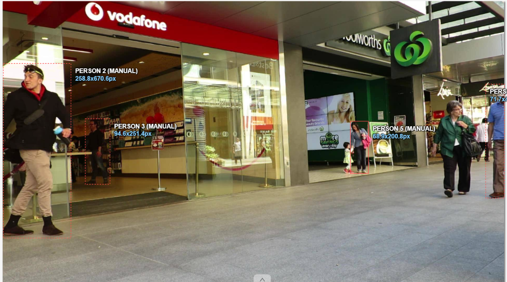
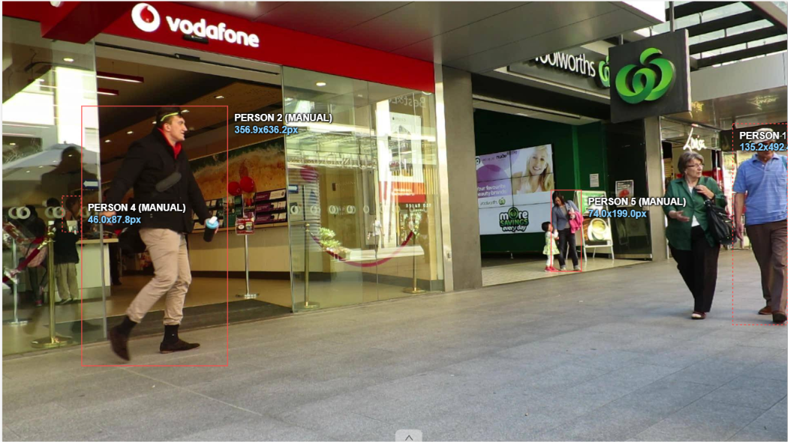
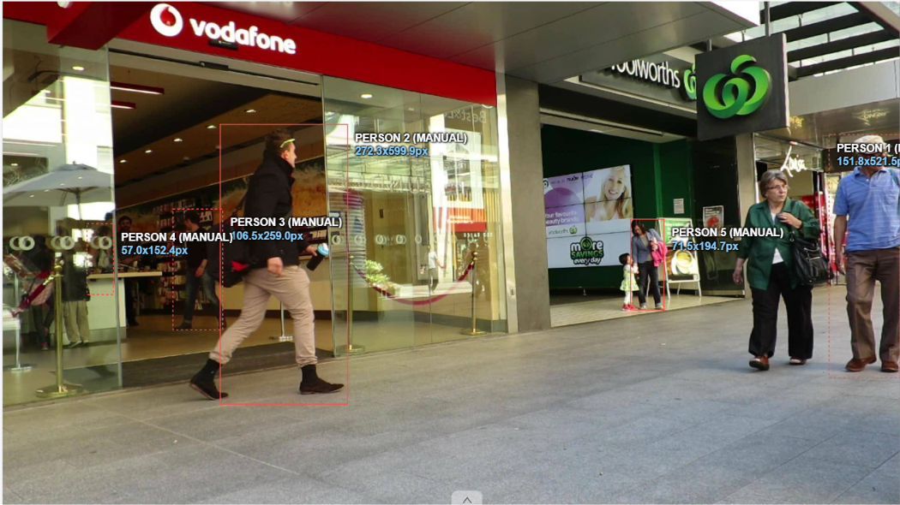

# Báo cáo cá nhân — Nguyễn Việt Anh-2A202603095

Đổi tên file theo quy tắc `MSSV_HoTen.md`. Ví dụ: `20241234_NguyenVanAn.md`.

Đoạn video: MOT17-09, 150 frame (frame 1–150), nguồn MOTChallenge, giấy phép CC BY-NC-SA 3.0.

## 0. Thông tin học viên

- Họ tên: Nguyễn Việt Anh
- MSSV: 2A202603095
- Mã đề (A/B/C): C
- Email: 26ai.anhnv5@vinuni.edu.vn
- Link repository: https://github.com/vietanhngx/K5-L2A-Day05-NguyenVietAnh-2A202603095-MOTTracking.git
- Giờ bắt đầu: 17:30
- Giờ kết thúc: 22:53

## 1. Xem trước đoạn video (CP0)

Ghi **trước khi vẽ**, mỗi người một dòng.

| Mã | Frame xuất hiện | Frame cuối thấy được | Rẽ / dừng / đổi tốc độ ở frame | Bị che ở frame | Ghi chú |
|---|---|---|---|---|---|
| P1 | 0 | 149 | 20 | 0–59, 100–119 (mất hẳn 39–44) | PERSON 3: người đàn ông mặc áo đen trong cửa hàng Vodafone. Ban đầu đứng trong cửa hàng; từ frame 20 quay mặt và bắt đầu đi ra ngoài. |
| P2 | 40 | 149 | Không ghi nhận | 40–99 | PERSON 4: người phụ nữ trong cửa hàng Vodafone; bắt đầu có nhãn ở frame 40. |
| P3 | 0 | 149 | Không ghi nhận | 0–69 | PERSON 1: ông cụ mặc áo xanh; ban đầu chỉ thấy cánh tay, sau đó xuất hiện dần. |
| P4 | 0 | 109 | Không ghi nhận | 100–109 | PERSON 5: người mẹ dắt theo con. |
| P5 | 0 | 149 | Không ghi nhận | 0–39, 120–149 (mất hẳn 120–129, 140–148) | PERSON 2: người đàn ông mặc áo đen đi trên phố. |

## 2. Keyframe và thời gian (CP1, CP4)

Số keyframe lấy từ kết quả `src/check_submission.py`.

| Mã | Số keyframe | Keyframe ở frame | Số frame có mặt | Keyframe / 100 frame | Thời gian (phút) | Chỗ khó |
|---|---|---|---|---|---|---|
| P1 | 15 | 0, 10, 20, 30, 45, 60, 70, 80, 90, 100, 110, 120, 130, 140, 149 | 144 | 10,4 | Không tách riêng | Bị người đi ngang che kín ở frame 39–44. |
| P2 | 12 | 40, 50, 60, 70, 80, 90, 100, 110, 120, 130, 140, 149 | 110 | 10,9 | Không tách riêng | Không có khó khăn đáng kể. |
| P3 | 16 | 0, 10, 20, 30, 40, 50, 60, 70, 80, 90, 100, 110, 120, 130, 140, 149 | 150 | 10,7 | Không tách riêng | Ban đầu chỉ thấy cánh tay, sau đó người xuất hiện dần. |
| P4 | 8 | 0, 10, 20, 30, 40, 50, 80, 100 | 110 | 7,3 | Không tách riêng | Không có khó khăn đáng kể. |
| P5 | 14 | 0, 10, 20, 30, 40, 50, 60, 70, 80, 90, 100, 110, 130, 149 | 131 | 10,7 | Không tách riêng | Không có khó khăn đáng kể. |
| **Tổng** | 65 | | 645 | 10,1 | | |

Keyframe / 100 frame của cả bài = tổng keyframe ÷ tổng số frame có mặt × 100 = 65 ÷ 645 × 100 ≈ 10,1.

Bạn đặt keyframe nhiều nhất ở người nào? Vì sao (người đó rẽ, dừng, lại gần camera hay bị che)?

P3, với 16 keyframe. Ban đầu chỉ nhìn thấy cánh tay, sau đó người xuất hiện dần trong khung hình nên tôi chỉnh box theo các mốc xuất hiện.

## 3. Đoạn bị che (CP2)

Người bị che: `P1`

| Mốc | Frame |
|---|---:|
| Bắt đầu bị che một phần (bật `occluded`) | 0; bật lại ở 100 |
| Mất hẳn (bật `outside`) | 39 |
| Hiện lại (tắt `outside`) | 45 |
| Thấy rõ trở lại (tắt `occluded`) | 60 và 120 |

- Thời gian khuất hẳn: 6 frame (39–44) = 0,20 giây.
- Quyết định: giữ cùng ID.
- Lý do (trả lời 3 câu: khuất bao lâu so với 60 frame, ngoại hình có khớp, chỗ hiện lại có đúng hướng và tốc độ):

P1 bị che hoàn toàn trong 6 frame (39–44), tương đương 0,20 giây, dưới ngưỡng 60 frame. Người này vẫn ở vị trí đó, chỉ tạm bị người đi ngang che khuất nên giữ cùng ID khi nhìn thấy trở lại ở frame 45.

Ảnh chụp màn hình:





## 4. Tự review ID (CP3)

Lượt 1 theo người (đi ngược từ frame 149 về 0 trên CVAT), lượt 2 theo cảnh (nhảy 10 frame). Ít nhất 3 dòng; không có lỗi thì ghi một dòng "đã kiểm hai lượt, không lỗi".

Loại lỗi dùng đúng một trong 7 mã: `id_switch`, `fragmentation`, `lost`, `merge`, `false_track`, `drift`, `flag`.

| Frame | Mã người | Loại lỗi | Mô tả một câu | Phát hiện ở lượt | Đã sửa? |
|---:|---|---|---|---|---|
| 39–44 | P1 | `flag` | Quên bật `outside` khi P1 bị người đi ngang che kín hoàn toàn. | Đã kiểm đủ hai lượt; lỗi xác định khi đối chiếu lại đoạn che | Có |
| | | | | | |
| | | | | | |

Tổng hợp số lỗi theo loại:

| `id_switch` | `fragmentation` | `lost` | `merge` | `false_track` | `drift` | `flag` |
|---:|---:|---:|---:|---:|---:|---:|
| 0 | 0 | 0 | 0 | 0 | 0 | 1 |

Lỗi nào chỉ lượt 2 (theo cảnh) mới thấy, lượt 1 (theo người) không thấy? Vì sao?

Không có lỗi nào chỉ phát hiện ở lượt 2.

## 5. File xuất và kết quả tự kiểm (CP4)

| Kiểm tra | Kết quả |
|---|---|
| Tên file MOT 1.1 | `NguyenVietAnh_mot.zip` |
| Tên file CVAT for video 1.1 | `NguyenVietAnh_cvat_video.zip` |
| Số track ID khác nhau trong `gt/gt.txt` (phải là 5) | 5 |
| Frame `outside` không có dòng trong `gt.txt` (đúng / sai) | Đúng |
| Job đã completed trên CVAT máy cá nhân | Đã completed |

Dán phần tóm tắt in ra từ `src/check_submission.py`:

```text
Số track ID: 5
Tổng số box: 645
Tổng: 65 keyframe / 645 frame có mặt = 10.1 keyframe / 100 frame

=== Tóm tắt ===
  Lỗi: 0   |   Cảnh báo: 0
  Đạt. Dán phần tóm tắt này vào báo cáo mục 5.
```

## 6. Ba câu kết

1. Nếu được gán lại, bạn sẽ đặt keyframe khác ở đâu? Vì sao?

   Nếu được gán lại, tôi sẽ giữ cách đặt keyframe như hiện tại.

2. Có chỗ nào bạn không chắc "cùng ID hay ID mới"? Bạn đã quyết định và ghi chú thế nào?

   Tôi không có đoạn nào phân vân giữa cùng ID hay ID mới.

3. Một lỗi ID trong job của bạn (nếu không còn sót, chọn lỗi đã sửa) có thể làm xe tự lái dự đoán sai chuyển động của người đó như thế nào? Lỗi đó ảnh hưởng MOTA hay IDF1 nhiều hơn?

   Tôi quên bật `outside` khi P1 bị che kín, khiến hệ thống tưởng vẫn nhìn thấy người và có thể dự đoán sai vị trí. Lỗi này có thể làm tăng box thừa và giảm MOTA; đây là lỗi cờ, không phải đổi ID.

## Bonus (nếu làm)

### B1 — Hai người đi sát

...

### B2 — So cách đặt keyframe

| Cách đặt | Số keyframe | Frame trôi nhất | Ghi chú |
|---|---:|---:|---|
| Đều mỗi 30 frame | | | |
| Theo chỗ đổi hướng | | | |

...

### B3 — So với tracker có sẵn

| Frame | Mã người | Tracker làm gì | Nhãn của bạn | Giải thích (đoán rồi sửa / ghép IoU / box score thấp / ngoại hình) |
|---:|---|---|---|---|
| | | | | |
| | | | | |

## 7. Tài liệu tham khảo và công cụ AI đã dùng

- Nguồn dữ liệu và ảnh chụp: MOT17, MOTChallenge (Milan et al., 2016), CC BY-NC-SA 3.0.
- Tài liệu bài lab: `docs/GUIDELINE.md`, `docs/MOT_FORMAT.md`, `CHECKPOINTS.md`.
- Codex: hỗ trợ kiểm tra file xuất, tổng hợp số liệu và chỉnh câu chữ báo cáo.
